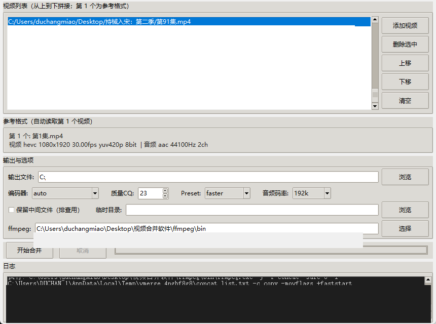

# 视频合并工具（多显卡自适应版）

按**第一个视频的格式**归一化并合并多个视频：编码、分辨率、帧率、像素格式、音频编码/采样率/声道不一致的分段自动转成参考格式再拼接；格式一致的分段直接流拷贝，不重编码。优先使用显卡 QSV 硬编，QSV 不可用时自动回退 CPU 软件编码，兼容各类显卡与无显卡环境。



## 目录结构

```
VideoMergeQSV\
├── app.py               # Tkinter 图形界面
├── merge_core.py        # 合并核心（探针分析 / 分段策略 / QSV 转码 / concat）
├── run.bat              # 双击运行
├── build.bat            # PyInstaller 打包成 exe
├── requirements.txt
├── README.md
└── ffmpeg\bin\          # ffmpeg.exe / ffprobe.exe
```

## 环境要求

- Windows 10 / 11 64 位
- Python 3.9+（界面只用标准库 Tkinter，无需 pip 安装第三方包）
- 带 QSV 的 ffmpeg（本目录 `ffmpeg\bin` 已放入 BtbN GPL 构建；源码仓库不携带该二进制，需按下方说明另行放置）
- 支持显卡 QSV 硬编加速；无可用显卡或驱动时自动软件编码，仍可正常运行

## 使用步骤

1. 双击 `run.bat`（或命令行 `python app.py`）。
2. “添加视频”，列表顺序就是拼接顺序；**默认第 1 个视频作为参考格式**。可以在列表中点选任意视频，也可以在“格式分类概览”中点选对应格式分组，将该分组的格式设为参考。
3. “格式分类概览”自动扫描全部视频并按编码/分辨率/帧率/像素格式/音频参数分组列出，绿色行为当前参考格式，其余为需要归一化的分组；参考切换后，编码器、CQ、码率等选项自动跟随，跟随之后仍可手动修改。
4. 选择输出文件，点“开始合并”。

命令行批量：

```bat
python merge_core.py --out merged.mp4 --files 1.mp4 2.mp4 3.mp4
```

可选参数：`--encoder auto|h264_qsv|hevc_qsv|av1_qsv|libx264|libx265`、`--rc-mode icq|vbr`、`--cq 23`、`--target-br 4000k`、`--max-br 6000k`、`--profile auto|baseline|main|high|main10`、`--preset faster`、`--audio-bitrate auto|128k|192k|256k|320k`、`--temp-dir 目录`、`--keep-temp`、`--skip-bad`（跳过无法读取/损坏的视频）、`--ref-index N`（指定第 N+1 个视频为参考格式，默认 0）。

大批量合并前会先把全部源文件探测一遍，集中列出无法读取/损坏的文件；默认遇到坏文件即中止，勾选“跳过无法读取/损坏的视频”（或命令行加 `--skip-bad`）后会自动排除坏文件继续合并。每个分段产物落地后会复核视频/音频流是否完整，临时盘空间不足时会给出警告。

## 工作原理

| 分段情况 | 处理方式 | 速度 |
|---|---|---|
| 视频、音频参数全部一致（含音频 Profile） | 流拷贝重封装，不重编码 | 极快 |
| 视频一致、音频不一致（编码/采样率/声道/Profile 不同） | 视频拷贝，音频转 AAC-LC 归一化 | 快 |
| 视频编码/分辨率/帧率/像素格式不一致 | QSV 硬编转成参考格式（失败自动软件回退） | GPU 加速 |

所有分段归一化后，用 concat 一次性 `-c copy` 封装成输出文件，**不做二次重编码**。

> 音频归一化会同时对齐编码、Profile（如 AAC-LC 与 HE-AACv2 混用）、采样率、声道；混用不同 Profile 的 AAC 直接拷贝进同一个 MP4 会导致封装时报 `Invalid data found when processing input`，本工具会自动把不一致段的音频重编码为统一的 AAC-LC。
> 每个分段只保留第 1 路视频和第 1 路音频，字幕/附件等无关流不会带入输出；源无音轨时自动补等长静音轨。

## 编码参数（默认跟随参考格式自动匹配）

| 参数 | 自动匹配规则 | 可选范围 / 说明 |
|---|---|---|
| 编码器 | 跟随参考编码：H.264→`h264_qsv`，HEVC→`hevc_qsv`，AV1→`av1_qsv` | 也可手动指定 QSV 或软件编码器 |
| 码率模式 | 默认 `icq`（质量优先） | `icq`=按质量值编码；`vbr`=按目标码率编码 |
| 质量 CQ | 按编码给默认值：H.264 23 / HEVC 24 / AV1 28 | 范围 18–32，越小越清晰、文件越大 |
| 目标码率 / 最大码率 | 按分辨率建议（720p 2500k、1080p 4000k、1440p 6000k、4K 8000k） | 仅 VBR 模式生效；最大码率默认目标的 1.5 倍 |
| Profile | 默认跟随参考视频 Profile | 可强制 baseline / main / high / main10 |
| Preset | 默认 `faster` | `veryfast` 最快，`slow` 质量更好但更慢 |
| 音频码率 | `auto` 按声道推导：单声道 128k、立体声 192k、多声道 320k | 可手动指定 128k/192k/256k/320k |
| 分辨率 / 帧率 / 像素格式 / 位深 | 全部归一到第 1 个视频；10bit 自动保持 p010 | 无需手动设置 |

- 源没有音轨时，自动补一条与参考采样率/声道一致的静音轨，保证拼接不断档。
- QSV 不可用或初始化失败时，自动回退 CPU 软件编码（libx264 / libx265）。

## 常见问题

- **日志出现 QSV 失败后自动 software**：驱动未装/未识别显卡，转码走 CPU，功能不受影响。
- **合并时报 `Invalid data found when processing input` / `Error muxing a packet`**：通常是某段音频 Profile 与参考不一致（如 HE-AACv2 混入 AAC-LC），当前版本已自动识别并把该段音频重编码归一化；若仍失败，临时目录下的 `ffmpeg_full.log` 保留了 ffmpeg 完整原始输出，可据此定位具体分段。
- **某文件解析失败被中止**：日志会给出具体文件名，先单独用播放器/ffprobe 检查该文件是否损坏、能否正常播放。
- **输出 MP4 时 HEVC 报错**：改用 `.mkv` 输出，或在界面把编码器选 `h264_qsv`。
- **10bit (HDR) 视频**：自动保持 p010 像素格式，HEVC Main10 用 `hevc_qsv`。
- **保留中间分段排查**：勾选“保留中间文件”，中间文件与 `ffmpeg_full.log` 都在临时目录。

## 打包成绿色便携版（目标机免装 Python）

双击 `build.bat`，自动安装 PyInstaller 并完成打包，产物在 `dist\`：

- `dist\VideoMergeQSV\` —— 便携目录，内含 `VideoMergeQSV.exe`、`_internal\`（Python 运行时与 Tk 界面库）、`ffmpeg\bin\`（ffmpeg / ffprobe）；
- `dist\VideoMergeQSV_portable.zip` —— 上述目录的压缩包，拷贝到任意 Windows 10/11 64 位机器解压后双击 `VideoMergeQSV.exe` 即可运行，**目标机不需要安装 Python、不需要安装 ffmpeg**。

携带方式：整个 `VideoMergeQSV` 文件夹一起拷贝（或解压 zip），不要只单独复制 exe；`ffmpeg\bin` 必须和 exe 保留同级目录结构。

环境说明：内置为 BtbN 静态构建 ffmpeg；显卡 QSV 不可用或未装驱动时自动回退 CPU 软件编码，功能不受影响。开发调试仍用 `run.bat`（需要本机 Python 3.9+）。
